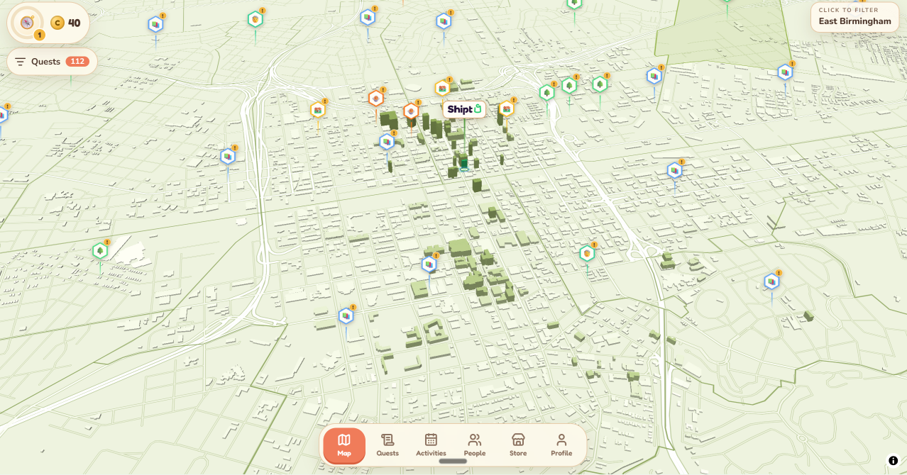
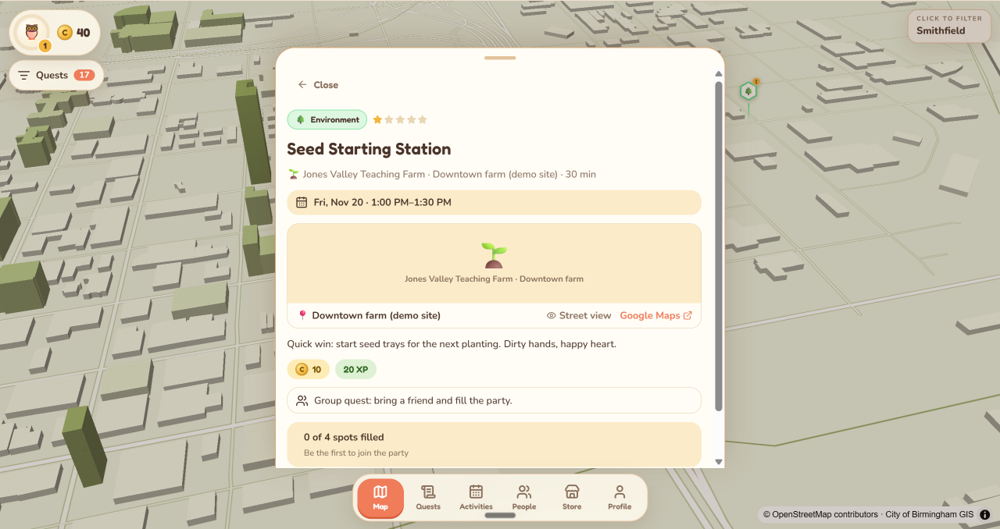
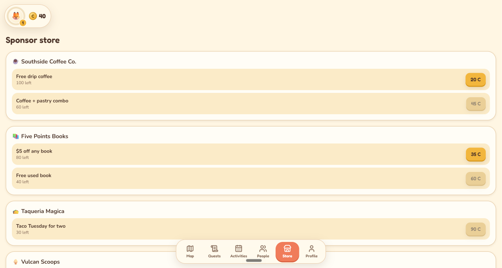
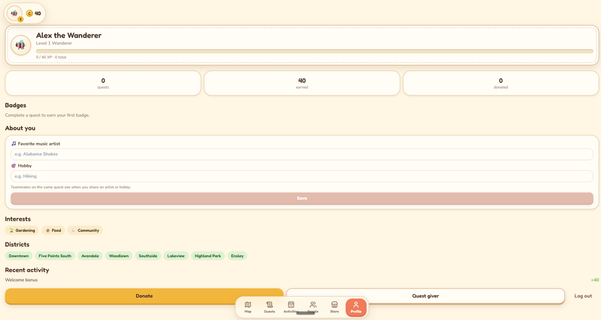
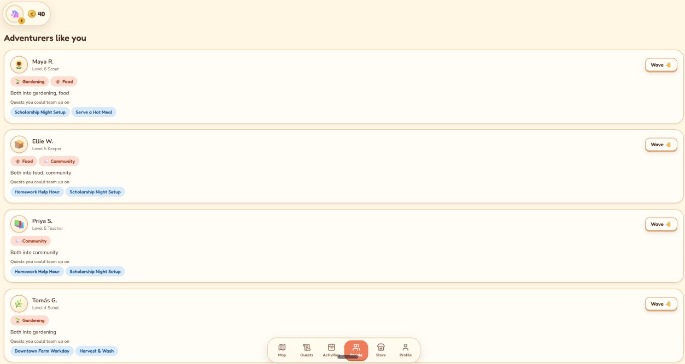

# RPG Birmingham

**Birmingham has things that need doing. Go do one.**

RPG Birmingham turns volunteering into a city-wide side-quest game. Local nonprofits post small, specific jobs (an hour in a teaching garden, a shift sorting food) as **quests** on a 3D map of Birmingham, AL. Adventurers pick a quest, show up, check in, finish with the host's 4-digit code, and earn **credits + XP**. Credits climb a leaderboard and can be spent at local sponsors or donated to causes.

Built for a hackathon. Partner organizations: Birmingham Promise, Firehouse Ministries, Jones Valley Teaching Farm and Ed Farm.

> **Demo app.** The organizations, quests, sponsors and other adventurers are **fictional**; the organizations have not endorsed this project. Sign-in is email-only (no passwords) on purpose.

## Screenshots

### The map
A 3D map of Birmingham built from OpenStreetMap buildings and the city's 99 official neighborhoods. Hex pins mark quests, colored by category. The Shipt landmark flies you to the HQ building.



### Quest details
Each quest shows its host, time slot, location (with Street view and Google Maps links), reward in credits and XP, and group-quest spots so you can bring friends.



### Sponsor store
Spend earned credits on rewards from local (fictional) sponsors. Items you can't afford yet are dimmed.



### Profile
Level and XP, badges, interests, favorite districts and recent activity. From here you can donate credits to a cause or open the quest-giver page.



### Adventurers like you
Matches by shared interests, with quests you could team up on.



## Features

- **Quest map:** browse about 100 quests across the region, filter by district or category, and get directions in Google Maps.
- **Quest loop:** sign up, check in on the day of the activity, then complete with the host's code to earn credits, XP, badges and level-ups.
- **Activities:** a calendar of the quests you've signed up for. Overlapping activities are blocked.
- **Group quests and chains:** fill a party for group quests; finish chained quests for bonus rewards.
- **Social:** leaderboard and "adventurers like you" matching by interests, favorite artist and hobby.
- **Sponsor store and donations:** redeem reward codes or donate credits to a cause.
- **Quest giver:** a `/giver` page where organizations post quests and see verify codes.

## Tech stack

- **Front end:** Next.js 14 (App Router), React 18, TypeScript, Tailwind CSS, [MapLibre GL](https://maplibre.org/) and SWR. A cozy design kit lives in `components/ui` and can be browsed at `/dev/ui`.
- **API:** one catch-all route, `app/api/[...path]/route.ts`, calling `lib/game.js` (game rules) and `lib/db.js` (data layer).
- **Database:** Supabase Postgres (`supabase/schema.sql`, tables prefixed `rpgb_`). With no database configured, `lib/db.js` falls back to in-memory storage and seed data.
- **Map data:** OpenStreetMap roads and buildings, plus City of Birmingham neighborhood boundaries, in `public/data/`.

## Run locally

Requires Node 20 or newer.

```bash
npm install
npm run dev          # http://localhost:8001
```

Open the site and use **Quick demo: sign in as Alex** (40 starter credits). The host check-in code for demo quests is `1234`.

With no database configured the data lives **in memory** and resets on restart. That is fine locally, but not on Vercel, where each serverless instance gets its own memory.

### Environment variables (optional)

Put these in `.env` (see `.gitignore`; never commit it).

| Variable | Purpose |
|---|---|
| `DATABASE_URL` | Postgres connection string, used by `npm run db:schema` to create the tables |
| `SUPABASE_URL` and `SUPABASE_SERVICE_ROLE_KEY` | Enable the persistent Supabase backend |
| `SESSION_SECRET` | Signs the session cookie |
| `DEMO_MODE` | Set to `false` to hide the demo host-code hint |

### Other scripts

```bash
npm run typecheck    # tsc --noEmit
npm run build        # production build
npm run db:schema    # apply supabase/schema.sql
```

## Demo script (about 3 minutes)

1. Open the site and sign in as Alex.
2. Tap a hex pin (or open the **Quests** tab), read the quest, then **Sign up**.
3. On the day, **Check in**, enter the host code, and **Complete** to collect credits, XP and badges.
4. Open **Activities** to see your calendar, and **People** to see matches.
5. Open **Store** to redeem a reward, or **Profile → Donate** to give credits to a cause.
6. Click the green **Shipt** landmark to fly to the HQ building.

## Deploy (Vercel + Supabase)

1. Create a Supabase project and add `SUPABASE_URL`, `SUPABASE_SERVICE_ROLE_KEY` and `SESSION_SECRET` as Vercel environment variables.
2. Pull them locally (`npx vercel env pull .env`) and run `npm run db:schema` to create the tables. Seed data is inserted on the first API request.
3. `npx vercel deploy --prod`.

## Project docs

- [`SYSTEM.md`](SYSTEM.md): system document and source of truth for scope and the demo path.
- [`docs/DESIGN.md`](docs/DESIGN.md): design system notes.
- `legacy/`: the earlier plain-JS prototype, kept for reference.

## Credits

Map data © OpenStreetMap contributors (ODbL). Neighborhood boundaries: City of Birmingham GIS. Shipt logo via Wikimedia Commons.
